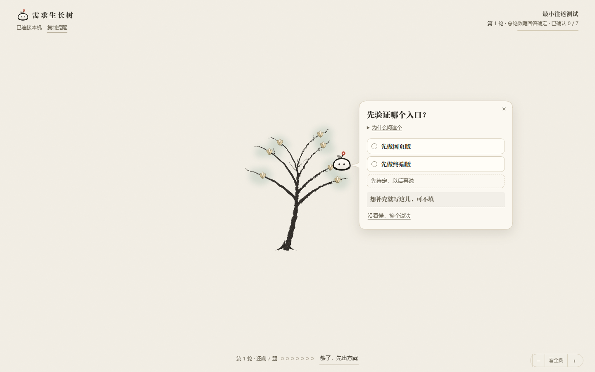
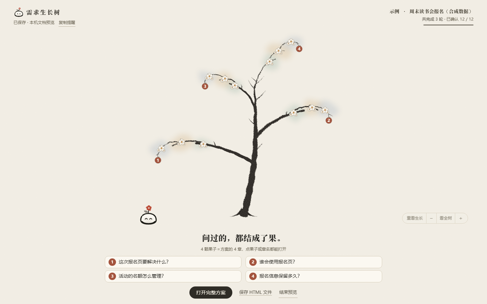

# grow-me · 让需求长成方案

把逐轮澄清搬到本机网页：小精灵「圆麻薯」停在一颗芽旁边问你一个问题，你答完，芽开成花，它接一句话；一轮答完，它提着篮子把答案送给 AI；追问沿着依赖长出新枝。保存后，每个话题结成一颗果子，点开就是方案里对应的一章。

**v0.3.0 · MIT 开源。** 使用 v2 访谈协议，v0.2 答了一半的访谈可以直接接着答。旧 v1 访谈只读，继续答题请用 [V1 试用版](https://github.com/Trunks820/grow-me/releases/tag/v0.1.0-alpha.1)。

[下载 v0.3.0 ZIP](https://github.com/Trunks820/grow-me/archive/refs/tags/v0.3.0.zip) · [全部版本](https://github.com/Trunks820/grow-me/releases)



## 怎么用

需要 Node.js 22+，以及一个能读取 `SKILL.md`、运行终端命令的 AI 编码助手。保存方案不再需要 Python。

### 跟 AI 一起梳理一个真实需求

下载 ZIP 解压，或者用 Git 克隆：

```sh
git clone https://github.com/Trunks820/grow-me.git
```

在 AI 助手里发送，把路径换成你的位置：

```text
读取 /你的路径/grow-me/SKILL.md，使用 grow-me 帮我澄清下面的需求。
启动本机网页让我逐题回答；收到整轮答案后继续追问。
没有必要的新问题时进入保存阶段，保存后生成方案网页。

需求：……
```

想让助手自动发现这个技能，就克隆到它的技能目录：

```powershell
# 支持 .agents/skills 的助手（Codex 等），Windows PowerShell
git clone https://github.com/Trunks820/grow-me.git "$env:USERPROFILE/.agents/skills/grow-me"

# Claude Code，装好后在 CC 里输入 /grow-me
git clone https://github.com/Trunks820/grow-me.git "$env:USERPROFILE/.claude/skills/grow-me"
```

macOS / Linux 把路径换成 `$HOME/.agents/skills/grow-me` 或 `$HOME/.claude/skills/grow-me`。已经装在 `.agents/skills/grow-me` 的，也可以从 `.claude/skills/grow-me` 建目录链接，两边共用一份。新技能没出现时，重开一次会话。

### AI 停了怎么办

本机服务不带模型、不需要 API Key：**AI 对话负责出题和写方案，网页负责答题和展示。** 你的答案只交给你正在用的 AI 助手。

- 能在后台等待的助手（如 Claude Code）会用等待命令：你一提交，它就被叫醒。做不到的助手每约 10 秒查一次。
- AI 出题、写方案期间，页面靠心跳和工作记录判断它还在，不会误报暂停。
- 真停了，圆麻薯会睡着、冒 zzz。点它会复制一段续接提醒，粘回原来的聊天窗口，喊一声"继续"就能接上。答过的题都存在 `tree.json` 里，不会丢。

### 先看看长什么样

```sh
cd grow-me
npm run demo
```

打开终端打印的本机网址。这是一份**合成的读书会需求**，只读：可以重看生长、点花回看、点果子打开对应章节。不调用 AI，也不代表真实模型的速度。点「结束预览」或按 Ctrl+C 退出。不用先 `npm install`。



## 答题时能做什么

- **点一下就定**：单选点选项即确认，芽开花、麻薯接一句话（台词由 AI 出题时预写，没写就用备用句），然后去下一题。多选和填空点「好了」。
- **补一句**：每题下面直接有输入框，想补充就写，不写也行。补充往往比选项更能改变方案。
- **先待定**：拿不准就选「先待定，以后再说」。这题算交了，AI 不会追问，方案里会列进"还没定的"，不会写成你已确认。
- **没看懂**：点「没看懂，换个说法」，可以写一句哪里没懂。AI 下一轮必须换个说法重问，不能原样再问。
- **送答案**：一轮最后一题定下，麻薯提着篮子出发，5 秒后自动交给 AI。这 5 秒里点「等等，我再看看」就能回去改。
- **够了，先出方案**：随时可以喊停。麻薯会先确认一句，没答的题记成待定。
- **改上游答案**：受影响的下游题变成黄叶，逐题复核。
- **刷新不丢**：点过的草稿存在这台电脑的浏览器里，刷新后恢复。

手机上题目从底部拉起一张卡片。系统开启「减少动态效果」时，生长、飞行和开花都直接显示结果。

## 保存后得到什么

- **方案网页**：开头三个框写清现在到哪了、下一步、还有几件没定；然后是"这一版做什么"、按编号排好的开发清单、一张验收表。访谈原话收在每章末尾，编号和会话信息收在页底"记录信息"里。章节写完一章发布一章，先写完的果子先能点开。
- **交接清单 `task.manifest.json`**：放在方案旁边，全文校验通过才写出，格式就是 [grow-loop](https://github.com/Trunks820/grow-loop) 的清单。每个开发项一个包，带依赖、验收标准、开工前要问你的问题（待定、没看懂的题），以及这包要照办的你的拍板原话；写了"撤不回的动作"的包（比如写线上数据库、发通知、付费调用），grow-loop 开工前会停下来等你批准。改动大小留给 grow-loop 开工前估。

## 当前边界

- 服务只监听 `127.0.0.1`，朋友要在自己电脑上运行，不是托管网站。
- 出题和写方案的快慢取决于 AI 助手和需求本身。
- 保存后不能再补答，方案也不能嵌进侧边面板；这两件留给以后的版本。
- 原始访谈、答案、聊天记录、本机日志都不在仓库里。提 Issue 或贴截图前，请去掉个人回答。

## 验证情况

- 自动测试：Node 测试和全部浏览器测试通过。
- 自带「模拟用户」（`tests/sim_user.py`）：会在真浏览器里替你答题，让被测的 AI 照常出题、写方案，跑完给打分报告。v0.3 前半段已用它在 Codex、Antigravity（Windows）和 Grok Bot、Muse Spark、dot（Linux）上跑通完整访谈，DeepSeek Harness 第 4 次跑通。
- 新界面（圆麻薯、送答案、没看懂、新版方案）已通过浏览器测试和模拟用户；还没在各个 AI 工具里重跑，Cursor 也还没验。欢迎带着真实需求试用。

### 帮忙试用时，记这四个时间

| 指标 | 起点 | 终点 |
| --- | --- | --- |
| 发现提交 | 答案交给 AI（篮子送出） | AI 读到这一轮答案 |
| 每轮出题 | 答案交给 AI；黄叶场景从最后一题复核确认算起 | 下一轮第一题可以答 |
| 首章可读 | 点「保存并生成」 | 第一颗果子能打开对应章节 |
| 全文完成 | 同上 | 全部章节和三个视图生成、校验完成 |

请附上题数、章节数、所用助手和模型、操作系统。还标着「生成中」的果子不算可读。

[反馈 Bug 或试用结果](https://github.com/Trunks820/grow-me/issues)

## 开发与验证

运行 grow-me 只要 Node。Python 只用于开发测试（浏览器测试和模拟用户）。

```sh
npm test
python -m pip install -r requirements-dev.txt
python -m playwright install chromium
# 浏览器测试：tests/ 下每个 *_browser.py，加上下面几个
python tests/browser_acceptance.py --work outputs/qa/browser
python tests/seeded_growth.py --work outputs/qa/seeded
python tests/schema_acceptance.py
```

每个 `*_browser.py` 都用同样的方式运行：`python tests/<名字>.py --work outputs/qa/<名字>`。

拿一个真实 AI 工具自测：让它按上面的方式开一场访谈，同时运行

```sh
python tests/sim_user.py --auto --find <访谈目录> --report outputs/qa/sim-report.json
```

Linux（包括启用 PEP 668 的 Debian/Ubuntu）先 `python3 -m venv .venv` 再 `. .venv/bin/activate`，在虚拟环境里运行。只需要 Chromium；`--with-deps` 可选，要 root 和 apt。Chromium 下载失败可以换镜像：

```sh
PLAYWRIGHT_DOWNLOAD_HOST=https://cdn.npmmirror.com/binaries/playwright python -m playwright install chromium
```

方案校验器（`scripts/validate-task.mjs`、`read-task.mjs`）最早移植自 ai-dev-workflow，现在两边独立维护，定期对照同步格式规则。接口见 [数据与 HTTP 合约](references/contract.md)，写方案的流程见 [progressive writer](references/progressive-writer.md)。

## License

[MIT](LICENSE) · Copyright 2026 Trunks820
